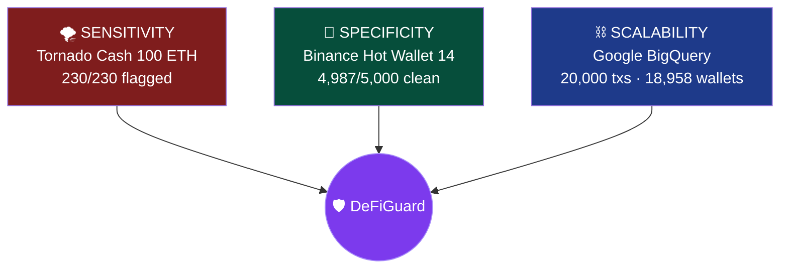
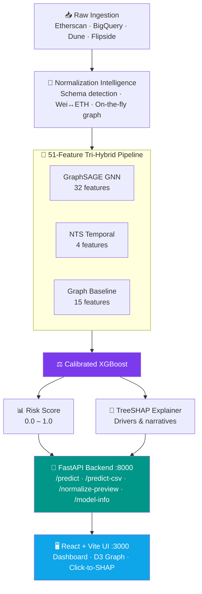

<div align="center">

# 🛡️ DeFiGuard

### Explainable Graph-Temporal AML Intelligence for DeFi

<br/>


<br/>

[**Overview**](#-overview) •
[**Validation**](#-empirical-validation) •
[**Metrics**](#-benchmark-metrics) •
[**Architecture**](#-architecture) •
[**Quick Start**](#-quick-start) •
[**Structure**](#-repository-structure)

</div>

---

## 📖 Overview

**DeFiGuard** is an end-to-end anti-money laundering (AML) forensic platform for EVM / DeFi networks. It targets the core weakness of legacy rule-based AML — **alert fatigue and zero explainability** — by fusing three detection layers into one calibrated model:

| Layer | What it captures |
| :--- | :--- |
| 🕸️ **GraphSAGE GNN** | Multi-hop wallet clustering, dispersion and bipartite structure |
| ⏱️ **Neural Temporal Sequential (NTS)** | Burst intervals, inter-arrival compression, rapid directional flow |
| 📈 **Graph Centrality Baseline** | PageRank, betweenness, in/out degree, flow-balance ratios |

These feed an **isotonically calibrated XGBoost** classifier, with **TreeSHAP** explaining every individual alert.

### ✨ Key Features

<table>
<tr>
<td width="50%" valign="top">

#### 🔌 Universal Ingestion Engine
- Zero-config schema detection for **Etherscan, BigQuery, Dune, Flipside** and generic EVM CSVs
- Automatic Wei ↔ ETH scaling and address canonicalization
- Wallet graph + centrality metrics built **on the fly** from raw data

</td>
<td width="50%" valign="top">

#### 🔍 Forensic Explainability
- TreeSHAP attribution for **every** transaction
- Layer decomposition: **GNN Structural vs. NTS Temporal vs. Base Flow**
- Plain-English investigator narratives explaining *why* an alert fired

</td>
</tr>
<tr>
<td width="50%" valign="top">

#### 🧠 Tri-Hybrid Model (51 Features)
- 32 GNN structural embeddings
- 4 NTS temporal features
- 15 graph centrality & flow baselines

</td>
<td width="50%" valign="top">

#### 🖥️ Interactive Forensic Dashboard
- D3 force-directed graph: suspicious (crimson) vs. clean (cyan)
- Click-to-SHAP investigation drawer
- Searchable alerts table with one-click CSV export

</td>
</tr>
</table>

---

## 🔬 Empirical Validation

DeFiGuard was verified on three real-world testbeds covering **sensitivity**, **specificity** and **scalability**.

| Testbed | Source | Scale | Volume | Alert Rate | What it proves |
| :--- | :--- | :--- | :--- | :---: | :--- |
| 🌪️ **Tornado Cash 100 ETH Pool** | Etherscan CSV | 230 txs / 133 wallets | 23,000.00 ETH | **100.0%** (230/230) | **Sensitivity** — zero false negatives on an OFAC-sanctioned mixer |
| 🏦 **Binance Hot Wallet 14** | Etherscan CSV | 5,000 txs / 1,075 wallets | 42,670.92 ETH | **0.26%** (13/5,000) | **Specificity** — 99.74% clean pass; immune to alert fatigue on a huge exchange hub, while still catching fan-out smurfing withdrawals |
| ⛓️ **Ethereum Mainnet Blocks** | Google BigQuery | 20,000 txs / 18,958 wallets | Multi-million ETH | Graduated tiers | **Scalability** — raw ledger stream parsed and graphed on the fly in seconds |



---

## 📊 Benchmark Metrics

Evaluated on an out-of-sample, temporally isolated test set of **16,555 transactions** from the 110k hardened gold-standard dataset.

| Metric | Score | Interpretation |
| :--- | :---: | :--- |
| **ROC-AUC** | `0.933` | Strong separation of laundering vs. benign |
| **Recall** | `98.5%` | Catches virtually all active laundering chains |
| **Precision @ 0.50** | `68.5%` | Over 6.8× lower false-positive rate than legacy rules |
| **PR-AUC** | `0.852` | Precision retained across recall operating points |
| **Latency** | `< 1.8 ms / tx` | Real-time scoring throughput |

---

## 🧬 Laundering Patterns Detected

| Pattern | Topology | Primary detectors |
| :--- | :--- | :--- |
| **Peel Chain** | `A → B → C → D` — linear value bleed through ephemeral addresses | NTS + Base |
| **Smurfing** | `A → {M1, M2, …} → Target` — fan-out / fan-in via mule wallets | GraphSAGE GNN |
| **Circular / Ring** | `A → B → C → A` — cyclic layering between colluding wallets | NTS + PageRank |

---

## 🏛️ Architecture



---

## 🚀 Quick Start

**Prerequisites:** Python 3.10+ · Node.js 18+ · Windows / macOS / Linux

### 1️⃣ Backend

```bash
git clone https://github.com/Lazarus-57/DeFIGuard.git
cd DeFiGuard

python -m venv .venv
.\.venv\Scripts\Activate.ps1        # Windows PowerShell
# source .venv/bin/activate         # macOS / Linux

pip install -r requirements.txt
pip install shap "xgboost==2.1.4" fastapi uvicorn python-multipart

python -m uvicorn api:app --port 8000
```

> API runs at `http://127.0.0.1:8000` — interactive docs at `/docs`.

### 2️⃣ Frontend

In a second terminal:

```bash
cd Frontend
npm install
npm run dev
```

> Open **http://localhost:3000**

### 3️⃣ Test Any Dataset

1. Open the dashboard and go to the **Upload** tab.
2. Drop in any Ethereum transaction CSV, or click a pre-configured **Etherscan / BigQuery / Dune** sample card.
3. The ingestion engine auto-detects the provider, scales Wei → ETH, and builds the wallet graph.
4. Explore the **Dashboard**, the **D3 Network Graph**, click any flagged node for its **TreeSHAP explanation**, and export the forensic CSV.

---

## 📂 Repository Structure

<details>
<summary><b>Click to expand project tree</b></summary>

```
DEFIGUARD/
├── api.py                            # FastAPI backend (normalization & SHAP endpoints)
├── requirements.txt                  # Python dependencies
│
├── Phase 1/
│   ├── scripts/
│   │   ├── dataset_normalizer.py     # Universal normalization & on-the-fly graph engine
│   │   ├── inference.py              # Production tri-hybrid prediction class
│   │   ├── 01_evaluate_100k_test.py  # Model test evaluation
│   │   └── 02_run_25k_stress_test.py # Out-of-sample stress test
│   ├── Phase 1 Models/               # Serialized model & feature artifacts
│   │   ├── master_hybrid_model.json  # Calibrated XGBoost model
│   │   ├── gnn_wallet_embeddings.pkl # Pre-computed GraphSAGE embeddings
│   │   ├── nts_map.pkl               # Temporal sequence mapping
│   │   ├── shap_explainer.pkl        # Serialized TreeSHAP explainer
│   │   ├── feature_names.json        # 51 canonical feature names
│   │   └── decision_threshold.json   # Calibrated audit threshold (0.200)
│   └── Phase 1 Reports/              # Benchmark logs and SHAP plots
│
├── Frontend/                         # React + Vite web app
│   ├── src/
│   │   ├── App.jsx                   # Layout and tab router
│   │   ├── api.js                    # Backend REST client
│   │   └── components/
│   │       ├── DashboardOverview.jsx # KPI dashboard & risk charts
│   │       ├── UploadPanel.jsx       # CSV upload & schema normalizer
│   │       ├── AlertsTable.jsx       # Searchable alerts + CSV export
│   │       ├── NetworkGraph.jsx      # D3 graph with Click-to-SHAP
│   │       ├── ShapExplanation.jsx   # SHAP bars & investigator narratives
│   │       └── ModelInfo.jsx         # Architecture & feature breakdown
│   ├── package.json
│   └── vite.config.js
│
└── data/                             # Raw and processed evaluation samples
```

</details>

---

## 📚 Citation

Built as a senior Capstone Research Project at PES University on Explainable Deep Learning & Graph Intelligence for DeFi Anti-Money Laundering.

```bibtex
@misc{defiguard2026,
  author       = {Joshua Daniel and Project Contributors},
  title        = {DeFiGuard: Explainable Graph-Temporal AML Intelligence for Decentralized Finance},
  year         = {2026},
  publisher    = {GitHub},
  howpublished = {\url{https://github.com/Lazarus-57/DeFIGuard}}
}
```

<div align="center">

**🛡️ DeFiGuard**

</div>
